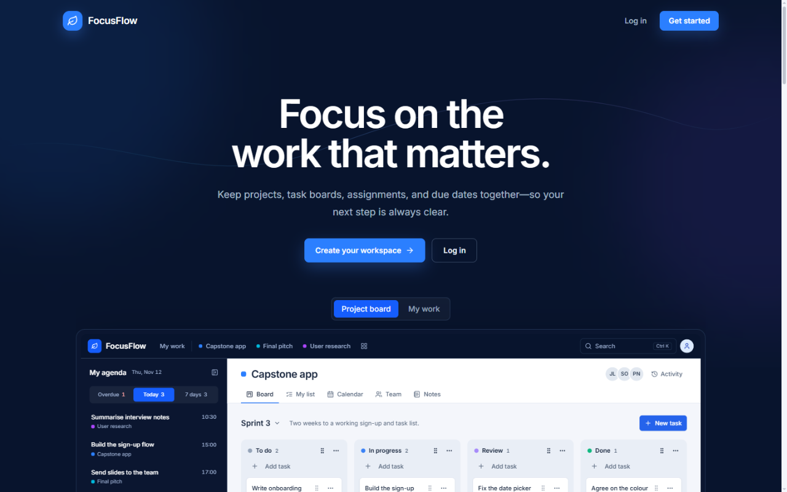
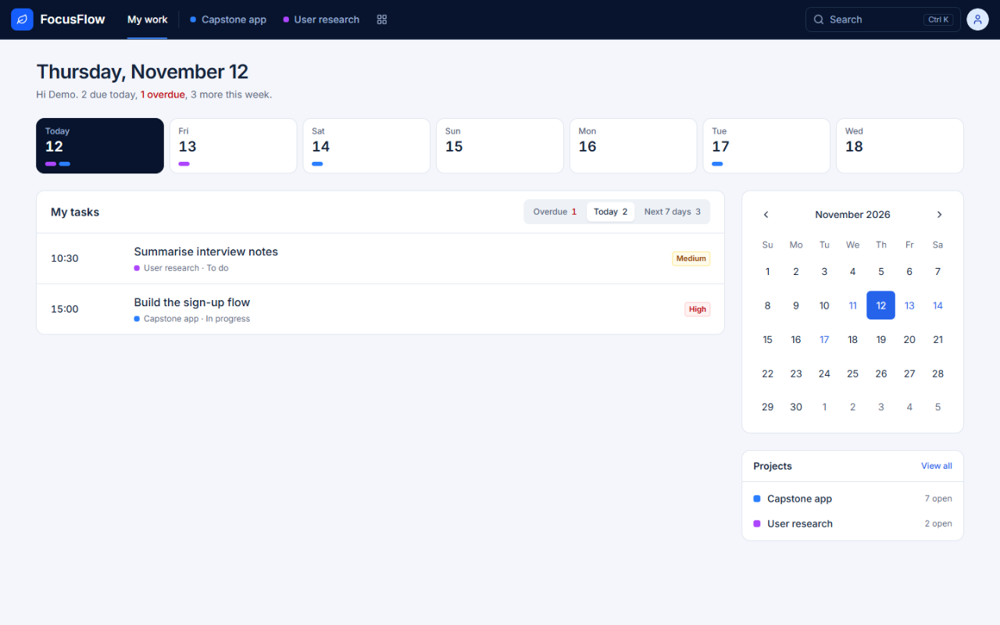
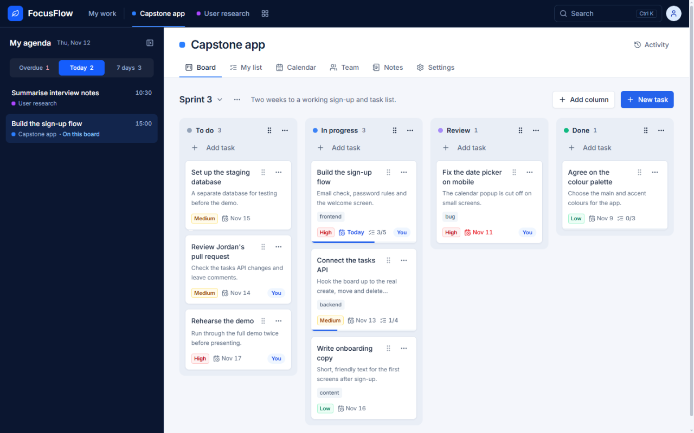
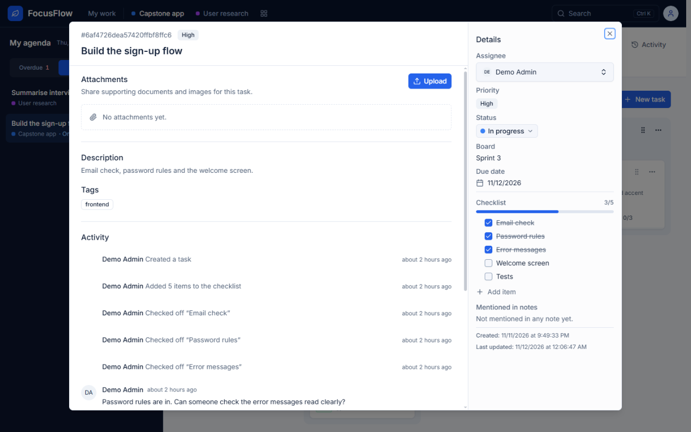
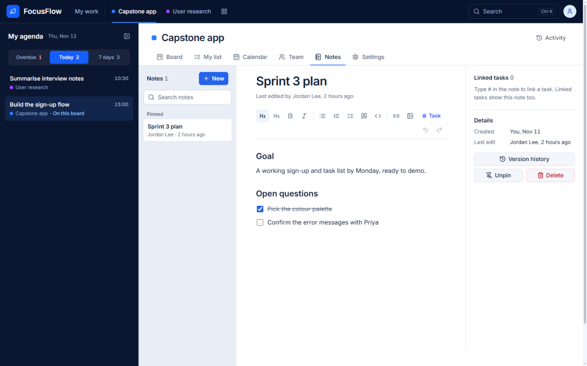
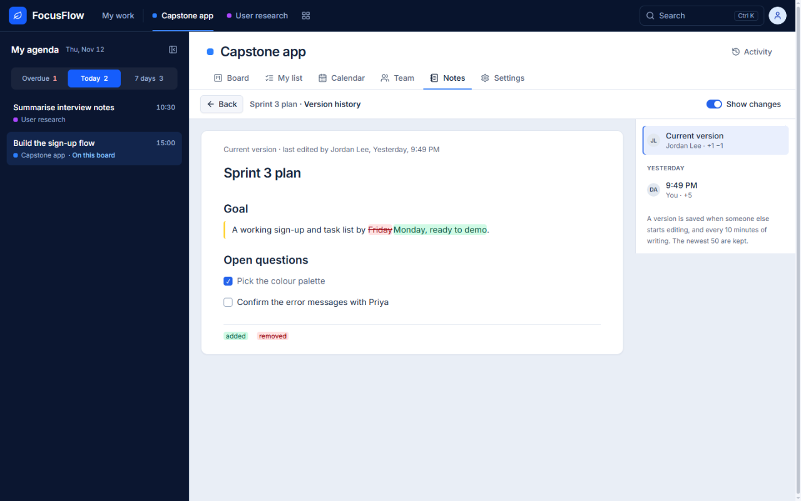
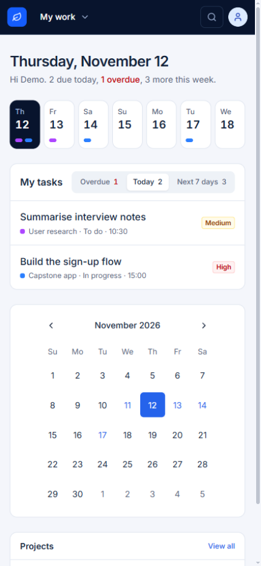
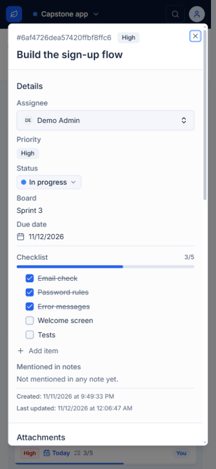
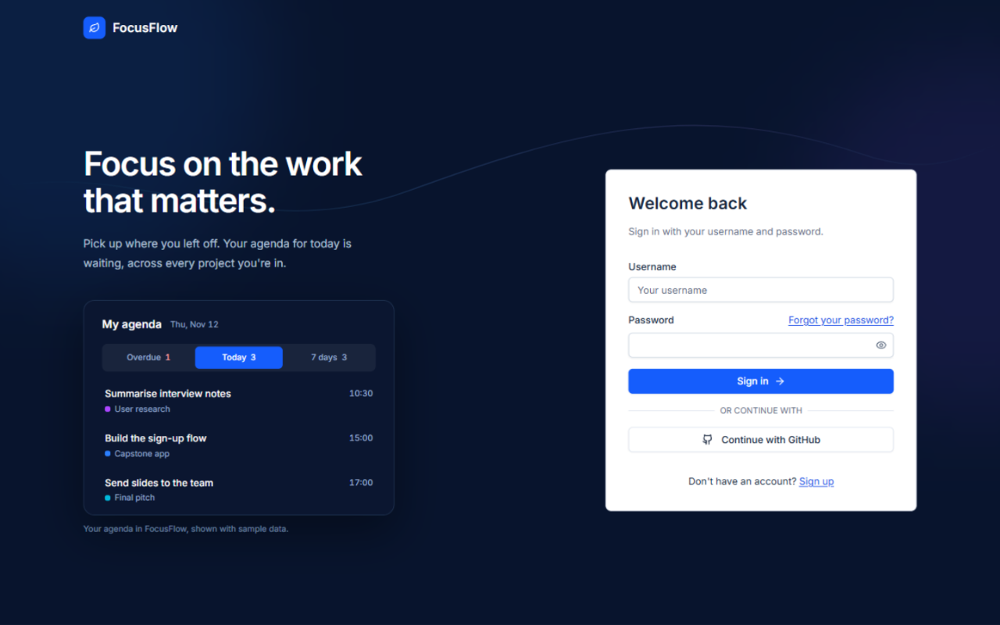
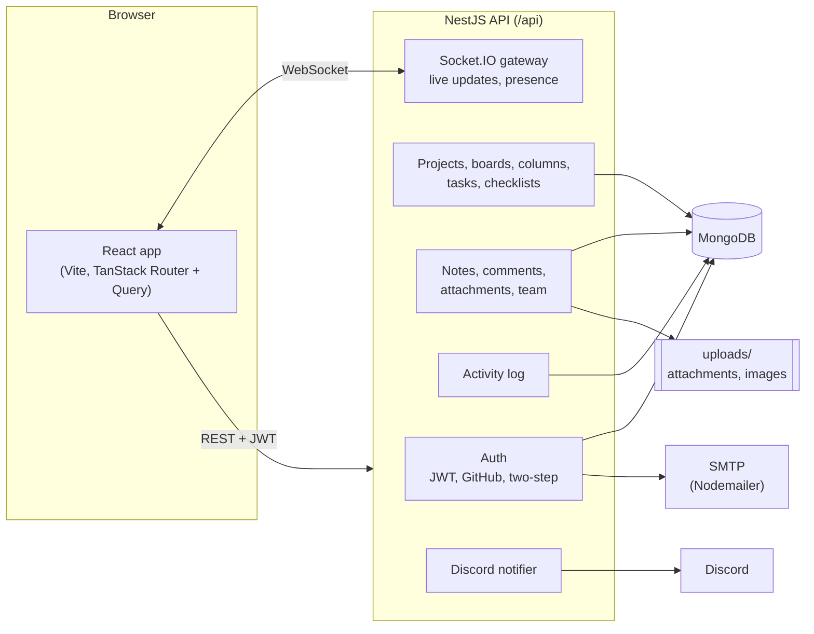

<div align="center">

# FocusFlow

**Plan the work together. Know what's yours today.**

A project-management app for students and small teams: shared boards for the plan,<br>
and a personal agenda that tells each person what's overdue, due today and coming up.



</div>

---

## Why FocusFlow?

Most task tools are great at showing *the project* and bad at answering *"what should I do next?"*. FocusFlow does both. Your team plans on a board, and every task with an owner and a date shows up in that person's **My work** page, across every project they're in. Open the app, see your day, get going.

It's deliberately small: no billing, no analytics dashboards, no AI buzzwords. It's just the parts a student team actually uses, built properly.

## A quick tour

### Your day at a glance
**My work** gathers everything assigned to you: what's overdue, what's due today (with times), and the week ahead, plus a calendar and your projects.



### Plan on a board
Name your own columns and drag tasks and columns around. Cards show the owner, priority, due date, tags and checklist progress at a glance. Your agenda stays docked on the left, so you never lose track of your own work while you look at the team's.



### Everything about a task in one place
Assign it, set a status and due date, tick off the checklist, attach files and talk it through. The task keeps its own history: who moved it, who changed what, and when.



### Notes that sit next to the work
Write project notes with headings, checklists, code and images, and type `#` to link a task. Every save keeps a version, so you can see exactly what changed and restore an older one.

| Writing a note | Comparing versions |
| --- | --- |
|  |  |

### Works on your phone
The board stacks, the task window turns into one scrolling page, and the agenda opens from a button.

<p align="center">
  
  &nbsp;&nbsp;
  
</p>

### Sign in safely
Use a username and password or GitHub. You can turn on **two-step sign-in** with an authenticator app, with a code by email as a backup.



## Features

| Area | What you get |
| --- | --- |
| **Projects and boards** | Several boards per project, custom columns, drag and drop for tasks and columns |
| **Tasks** | Owner, priority, due date and tags (description and date are optional), checklists with progress on the card |
| **My work** | Overdue, today and next 7 days across all projects, week strip, month calendar |
| **Project views** | Board, My list, Calendar, Team, Notes, Settings |
| **Notes** | Rich text, `#` task links, pinning, version history with restore |
| **Collaboration** | Comments, attachments (PDF, images, Word, text up to 5 MB), owner, admin and member roles, activity log |
| **Live updates** | Board changes and who's online appear without refreshing |
| **Search** | `Ctrl K` jumps to any project or task |
| **Accounts** | Email confirmation, password reset, profile and avatar, GitHub sign-in, two-step sign-in |
| **Discord** | Optional bot that posts new tasks, finished work, new notes and a daily 8am summary to a channel |

## Architecture

FocusFlow is two apps: a **React** frontend and a **NestJS** API, with **MongoDB** for data.



**How a change flows through the system.** Say you drag a task to *Done*:

1. The board updates right away (an optimistic update in TanStack Query), then sends `PATCH /api/task/moved/:id` with your sign-in token.
2. Guards check that you're a member of the project, and the task service saves the move to MongoDB.
3. The activity log records who moved what. Teammates with the project open get the change over Socket.IO, and if Discord is connected, the channel gets a message.
4. Everyone's **My work** and the project's open-task counts come straight from the tasks, so they're always current.

**A few design choices worth knowing:**
- **One source of truth.** Counts and agendas are calculated from the tasks, not stored separately, so they can't drift.
- **Access is checked on the server for every request**, based on project membership and role. The frontend never decides who can see what.
- **Two-step sign-in** issues a short-lived ticket signed with its own secret after the password step, so the ticket can't be used as a login token.
- **The landing page renders the real components** with sample data in an isolated cache, so the preview always matches the app.

## Project structure

```
FocusFlow/
├── backend/                     NestJS API
│   ├── src/
│   │   ├── auth/                sign-up, login, JWT + GitHub strategies, two-step sign-in
│   │   ├── projects/            projects, live task counts, cleanup on delete
│   │   ├── board/  column/      boards and columns (with ordering)
│   │   ├── task/                tasks, moves, checklists, "My work" query
│   │   ├── note/                notes, task links, version history
│   │   ├── comment/  attachment/  task conversations and files
│   │   ├── team/                members, roles, Socket.IO presence gateway
│   │   ├── audit-log/           project activity log
│   │   ├── integrations/discord Discord bot and notifications
│   │   ├── user/                profile, avatar, password
│   │   ├── email/               mailer and email templates
│   │   ├── schema/              Mongoose models
│   │   └── lib/                 guards, decorators, pipes, validators
│   ├── scripts/                 local QA seed and checks
│   └── .env.example
│
├── frontend/                    React app
│   ├── src/
│   │   ├── routes/              file-based routes (TanStack Router)
│   │   ├── pages/               page components (landing, auth, My work, workspace)
│   │   ├── features/
│   │   │   ├── projectWorkSpace/  board, tasks, notes, calendar, list, activity, settings
│   │   │   ├── projects/        project list and forms
│   │   │   ├── teamMember/      team table, invites, roles
│   │   │   ├── auth/            sign-in forms, two-step sign-in
│   │   │   ├── settings/        profile, password, two-step setup
│   │   │   └── landing/         landing preview and sample data
│   │   ├── components/          app shell, agenda, command palette, shared UI (shadcn/ui)
│   │   ├── context/             auth context
│   │   └── lib/                 HTTP client, helpers
│   └── .env.example
│
└── docs/screenshots/            images used in this README
```

## Tech stack

| | |
| --- | --- |
| **Frontend** | React 19, TypeScript, Vite, TanStack Router and Query, Tailwind CSS, shadcn/ui, Tiptap, dnd-kit, Framer Motion, Zustand |
| **Backend** | NestJS 11, MongoDB + Mongoose, Passport (local, JWT, GitHub), Socket.IO, Nodemailer, discord.js, otplib, Swagger |
| **Testing** | Jest (backend), Vitest + Testing Library (frontend) |

## Getting started

You'll need **Node.js 20+** and a **MongoDB** database (a free MongoDB Atlas cluster works).

```bash
# 1. Backend: http://localhost:5000
cd backend
npm install
cp .env.example .env      # fill in MONGODB_URI and JWT_SECRET at least
npm run start:dev

# 2. Frontend: http://localhost:5173 (in a second terminal)
cd frontend
npm install
cp .env.example .env
npm run dev
```

Open http://localhost:5173 and create an account. The API docs (Swagger) are at http://localhost:5000/docs.

### Settings

Every setting is listed with a comment in [`backend/.env.example`](backend/.env.example) and [`frontend/.env.example`](frontend/.env.example).

- **Required:** `MONGODB_URI` and `JWT_SECRET`.
- **Email** (`SMTP_*`) sends confirmations, password resets and two-step codes. The app works without it; those emails just won't send. With Gmail, use an [app password](https://myaccount.google.com/apppasswords).
- **Optional:** GitHub sign-in, Discord and Sentry.

## Scripts

| Where | Command | What it does |
| --- | --- | --- |
| backend | `npm run start:dev` | Run the API, reloading on save |
| backend | `npm test` | Unit tests (Jest) |
| backend | `npm run build` · `npm run start:prod` | Production build and run |
| backend | `npm run seed:qa` | Create a local QA account with sample data |
| frontend | `npm run dev` | Run the app with hot reload |
| frontend | `npm test` | Component and unit tests (Vitest) |
| frontend | `npm run build` | Type-check and build for production |
| frontend | `npm run lint` | ESLint |

## Known limitations

- Two-step sign-in is for password accounts. GitHub accounts rely on GitHub's own security.
- Images placed inside notes stay on disk when their project is deleted. Everything else in the project is removed.
- Uploaded files live on the server's disk (`backend/uploads`), so a hosted setup needs persistent storage.
